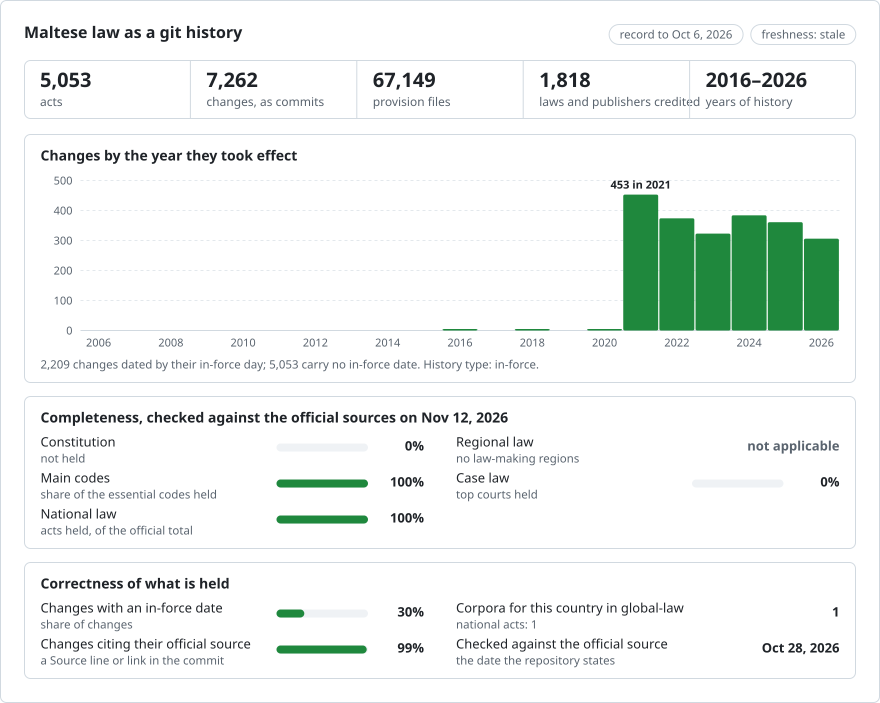

# Malta: law history in git

**English** · **[Jew aqrah bil-Malti](README.md)**

<picture>
<source media="(prefers-color-scheme: dark)" srcset="data/effort-dark.svg">

</picture>

The law of Malta as a git history: one file per article, regulation or schedule, one commit per version on the day it took effect, and the Act or Legal Notice that made each change as the commit's author. `git blame` names the law behind every line; `git log` lists every change to an article; picking a date gives the text in force that day.

Part of [lexifina/global-law](https://github.com/lexifina/global-law), one git history for every country's law: this is Malta's national law, which global-law reads at `malta/national/acts/`.

**What is in it now:** every Chapter (562) and piece of subsidiary legislation (4,522) on legislation.mt, 5,084 laws with 8,195 consolidated versions up to the point in time of 6 October 2026, in 10,495 commits; 31 of these laws have no text here, as their PDFs could not be read. [`laws.csv`](laws.csv) lists every law with its kind, whether it is in force, its versions and its folder.

Each law is a folder, `cap/<number>/` for a Chapter and `sl/<number>/` for subsidiary legislation (`cap/452/` is the Employment and Industrial Relations Act, Cap. 452; `sl/452.115/` the Annual Leave National Standard Order), with its front matter in `title.md`. Each article file ends with the notes the consolidation prints in its margin, such as `- Amended by: ...; XX.2022.2; ...` (Act XX of 2022, section 2).

The text is in English, from legislation.mt's English consolidated versions. The Maltese text, which prevails for most laws where the two differ (article 74 of the Constitution), is not part of this record.

## Questions as git commands

| Question | Command |
| --- | --- |
| Every change to article 2 of the Employment and Industrial Relations Act | `git log -p --word-diff -- cap/452/2.md` |
| Which law wrote each line of article 2? | `git blame cap/452/2.md` |
| Every version of the Act, with the day each took effect | `git log --format="%h %(trailers:key=In-force,valueonly,separator=)%(trailers:key=Consolidated,valueonly,separator=) %an" -- cap/452` |
| Article 2 as in force on 1 January 2024 | `python tools/in_force_on.py 2024-01-01 cap/452 2` |

**Outside git**, we also host this record publicly, for free:

- **[Ask Claude about Maltese law](https://global-law.lexifina.com/v1/try_claude?country=malta)**: opens Claude with a first question ready.
- **[Ask ChatGPT](https://global-law.lexifina.com/v1/try_chatgpt?country=malta)**: the same question in ChatGPT.
- **[Search Maltese law on our site](https://lexifina.com/law?country=malta&q=annual+leave)**: a search for "annual leave", with each provision's text and its versions, no account needed.
- **[Developer REST API](https://global-law.lexifina.com/v1/search_law?query=annual+leave&jurisdiction=malta)**: the same search as JSON, with no key. See the [documentation here](https://lexifina.com/api/global-law).

Both assistants read the record through the free Global law connector (MCP, `https://global-law.lexifina.com/mcp`); the first time, the chat gives you the link that adds it. Ask in English or in Maltese.

**Host it yourself easily.** All it takes is git and Python, and the tools run on your machine:

```sh
git clone --depth 1 https://github.com/lexifina/global-law && cd global-law
python3 tools/countries.py add malta/national/acts
python3 tools/law.py show 2026-01-01 malta/national/acts/cap/452/2.md
```

Opened in Claude Code, Cursor, VS Code or Codex, the clone also starts a local MCP server with the same tools ([MCP.md](https://github.com/lexifina/global-law/blob/main/MCP.md)).

## Dates

Each commit is dated at noon, Europe/Malta, on the point in time of the legislation.mt version that holds it (the day from which that text applies), and carries that day in a trailer:

- a change: `In-force:`, the point in time of the first version that shows it, with the amending law's publication day in `Published:` where legislation.mt gives one;
- each law's earliest version on legislation.mt: `Consolidated:`. It is one commit (`Kind: consolidated`) with the whole text and each article's margin history, so earlier changes are recorded there, not as commits;
- git cannot store dates before 1970, so the 15 earlier commits (from 28 June 1834) are dated from 1970-01-01, one second apart, with the real day in the trailer. Ask for a date with `tools/in_force_on.py`, not `git log --before`;
- a published commit is never rewritten: the 2,583 laws whose first version was dated a day late have later `Kind: correction` commits (3,222 in all) that name the days they correct, and `tools/in_force_on.py` applies them.

Each change is credited to the Act or Legal Notice that made it (`Act XX of 2022`, `L.N. 265 of 2026`), by the evidence in the consolidation, strongest first (`Evidence:`): a new citation in the article's margin, a single new law cited in the version, a single related law published between the two versions, and two rarer rules. That gives 1,965 amendment commits by 1,817 laws; each law's first version, and the 244 changes no law can be credited with (`Kind: unexplained`), are credited to the Legislation Unit.

## How it is checked

- `tools/build/` holds the build as it was run (`build.py`, `parse_pdf.py`, `docs.py`, their sha256 in `REPRODUCE.md`). From the same PDFs, whose sha256 are in [`data/pdf-sha256.tsv`](data/pdf-sha256.tsv), it gives the same commit hashes.
- Whitespace, curly quotes, dashes and soft hyphens are normalised away, so typesetting alone never makes a change; versions whose PDF could not be read are listed, not guessed.
- History is append-only: a wrong commit is corrected by a later one (`Corrects:`, `Supersedes:`, `Reason:`), never rewritten. See [`REPRODUCE.md`](REPRODUCE.md).

## What it does not show

- **The Constitution of Malta**, which legislation.mt publishes apart from the Chapters, and **case law**.
- **The Maltese text** (see above).
- **Text before each law's earliest version on legislation.mt**, except as its margin histories list the laws that changed it.
- **Unreadable versions**: 43 (41 of them Maltese text at the English address), listed in [`data/unreadable.csv`](data/unreadable.csv); they leave 31 laws without text.
- **Commencement later than a version's point in time, and savings and transitional rules**: these are in the amending laws, at each commit's `Source:` link.
- **Footnotes**, and the arrangement table at the start of each Chapter.

## Sources

| Source | Kind | Past versions | Notes |
| --- | --- | --- | --- |
| [legislation.mt](https://legislation.mt) (Legislation Unit, Government of Malta) | Official consolidated laws: Chapters and subsidiary legislation | yes, a consolidated version for each point in time | The English PDF of each version, each law's page (its versions and related laws) and the ELI sitemap; the Government Gazette is the authoritative text |

## Licence

See [`LICENSE`](LICENSE). The Copyright Act (Cap. 415, article 2) excludes "any written law" from literary works, save as provided in article 12 of the Statute Law Revision Act, 1980; the texts are reproduced without change to their wording. Lexifina's own contributions (tools, file arrangement, commit messages and documentation) are CC0 1.0.

## More

From [lexifina/global-law](https://github.com/lexifina/global-law):

- [FEATURES.md](https://github.com/lexifina/global-law/blob/main/FEATURES.md): every feature, and what every corpus must support (`git blame`, `law.py`, the MCP tools)
- [FAQ.md](https://github.com/lexifina/global-law/blob/main/FAQ.md): questions and answers · [CONTRIBUTING.md](https://github.com/lexifina/global-law/blob/main/CONTRIBUTING.md): proposing changes · [MCP.md](https://github.com/lexifina/global-law/blob/main/MCP.md): the MCP server · [REPRODUCE.md](https://github.com/lexifina/global-law/blob/main/REPRODUCE.md): how it was built · [CHANGELOG.md](https://github.com/lexifina/global-law/blob/main/CHANGELOG.md)
- [FRESHNESS.md](https://github.com/lexifina/global-law/blob/main/FRESHNESS.md): how current each corpus is · [Monitoring](https://github.com/lexifina/global-law/tree/main/monitoring): whether updates are running · [WATCHING.md](https://github.com/lexifina/global-law/blob/main/WATCHING.md): how each official source is watched for changes
- [performance/](https://github.com/lexifina/global-law/tree/main/performance): how fast the tools are, measured
- [visualisations/](https://github.com/lexifina/global-law/tree/main/visualisations): charts and bridges across the world's law
- [Vulnerabilities](https://github.com/lexifina/global-law/tree/main/vulnerabilities): mistakes in legislation as published
