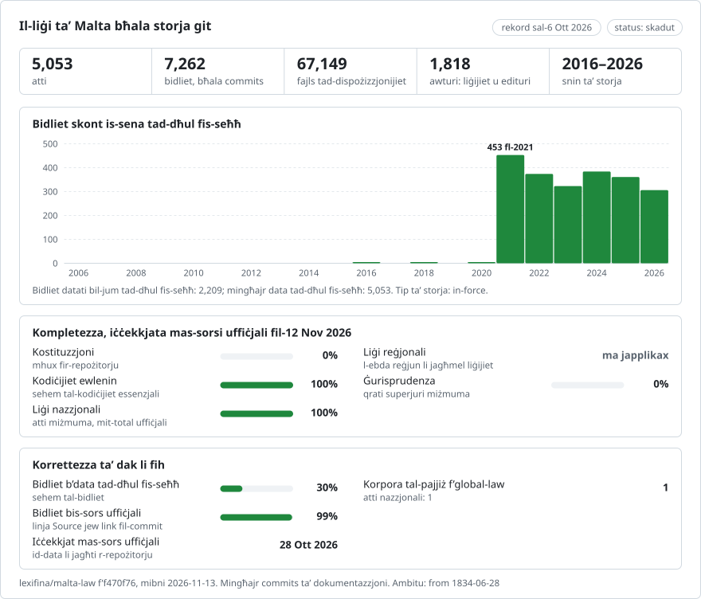

# Il-liġi ta’ Malta, bidla b’bidla

**Malti** · [English](README.en.md)

<picture>
<source media="(prefers-color-scheme: dark)" srcset="data/mt/effort-dark.svg">

</picture>

Parti minn [lexifina/global-law](https://github.com/lexifina/global-law), storja git waħda għal-liġi ta’ kull pajjiż: dan huwa d-dritt nazzjonali ta’ Malta, li global-law jaqra f’`malta/national/acts/`.

Il-liġijiet ta’ Malta bħala repożitorju git: 562 Kapitlu u 4,522 biċċa leġiżlazzjoni sussidjarja minn [legislation.mt](https://legislation.mt), is-sors uffiċjali ppubblikat mill-Unità tal-Leġiżlazzjoni. Hemm fajl wieħed għal kull artikolu, regolament jew skeda. Kull bidla hija commit attribwit lill-Att jew lill-Avviż Legali li għamilha, datat bil-jum li fih it-test mibdul daħal fis-seħħ, f’nofsinhar ħin ta’ Malta. Jintuża t-test Ingliż kullimkien.

Ir-rekord imur mit-1834-06-28 sat-2026-10-06 f’7,265 commit, mibni minn 8,195 verżjoni konsolidata.

## Il-mistoqsijiet ta’ avukat bħala kmandi git

| Mistoqsija | Kmand |
| --- | --- |
| X’kien jgħid l-artikolu 57 tal-Kodiċi ta’ Organizzazzjoni u Proċedura Ċivili fl-1 ta’ Ġunju 2022? | `python tools/in_force_on.py 2022-06-01 cap/12 57` |
| Liġi sħiħa f’data partikolari | `python tools/in_force_on.py 2022-06-01 cap/12` |
| Liema liġi biddlet l-aħħar kull linja ta’ artikolu? | `git blame cap/12/57.md` |
| Kull bidla f’artikolu, bil-liġi li ġabitha | `git log -p cap/12/57.md` |
| Dak kollu li biddel Att wieħed, fil-liġijiet kollha | `git log --author='Act XXV of 2026' --stat` |
| Kull liġi li biddlet Kapitlu, f’ordni | `git log --format='%(trailers:key=In-force,valueonly,separator=) %an' -- cap/12` |
| Dak li mhu attribwit lil ebda liġi | `git log --grep='Kind: unexplained'` |
| Il-lista tal-liġijiet, bil-verżjonijiet tagħhom | [`laws.csv`](laws.csv) |

Kull fajl ta’ artikolu jibda bin-numru u bit-titlu marġinali tiegħu (`# 57. Duties of Director General (Courts).`), b’kull intestatura ta’ Ktieb, Titolu jew Parti fuqu bħala linji `##`. Imbagħad tiġi linja waħda għal kull subartikolu, paragrafu jew proviso. Fl-aħħar, l-istorja li l-konsolidazzjoni tipprintja fil-marġni, ikkupjata kif inhi: `- Amended by: VI.1880.6; XV.1913.22.` Hawnhekk `VI.1880.6` tfisser l-Att (qabel l-1921, l-Ordinanza) VI tal-1880, artikolu 6.

## Id-dati, u liema minnhom nużaw

legislation.mt jippubblika kull liġi bħala serje ta’ verżjonijiet konsolidati, kull waħda għal “point in time” (punt fiż-żmien): il-jum minn meta japplika dak it-test. **Il-commits huma datati b’dak il-jum.** Dik hija d-data li tiddeċiedi liema test jirregola kawża, u hija wkoll il-jum li fih daħlu fis-seħħ l-emendi f’dik il-verżjoni. Kull commit ta’ emenda jġorr ukoll id-data tal-pubblikazzjoni tal-liġi emendatorja, fejn legislation.mt jagħtiha (`Published:`).

Ir-rekord jibda mill-ewwel verżjoni ta’ kull liġi fuq legislation.mt, l-aktar minn Diċembru 2020, meta s-sit attwali beda jżomm il-verżjonijiet; xi liġijiet għandhom verżjonijiet aktar kmieni. Dik l-ewwel verżjoni hija commit immarkat `Kind: consolidated`, mill-Unità tal-Leġiżlazzjoni. Fiha t-test kollu kif kien dak iż-żmien, bl-istorja marġinali ta’ kull artikolu, għalhekk l-istorja ta’ qabel dik id-data hija rreġistrata, iżda mhux bħala commits separati.

**Git ma jistax jaħżen dati ta’ qabel l-1970.** Liġi li l-ewwel verżjoni tagħha hija eqdem minn hekk tiġi kkommittjata fl-1970-01-01, sekonda bejn waħda u oħra u f’ordni. Id-data vera tagħha tinsab fit-trailer `Consolidated:` jew `In-force:`, li jaqrah `tools/in_force_on.py`.

**Korrezzjonijiet.** Commit ippubblikat qatt ma jinkiteb mill-ġdid. Fejn wieħed kien żbaljat, commit aktar tard immarkat `Kind: correction` jgħid hekk: `Corrects: <law> <from>..<to>` jagħti l-ġranet li għalihom japplika (tarf miftuħ jibqa’ sal-verżjoni li jmiss tal-liġi), `Files:` il-fajls li jistabbilixxi, `Supersedes:` il-commit li jikkoreġi u `Reason:` għaliex. Fit-2026-11-03, 2,583 liġi kellhom l-ewwel verżjoni tagħhom ippubblikata jum tard (id-data proprja tal-verżjoni hija dik fl-ELI `Version:` tagħha); il-korrezzjonijiet tagħhom jagħtu dak il-jum. `tools/in_force_on.py` japplika l-korrezzjonijiet.

## X’ifisser “awtur”

L-awtur ta’ commit huwa l-liġi li għamlet il-bidla, f’indirizz li ma jistax jeżisti: `Act XXV of 2026 <act-2026-25@legislation-mt.invalid>`, `L.N. 218 of 2026 <ln-2026-218@legislation-mt.invalid>`. B’hekk `git blame` jsemmi, għal kull linja, il-liġi li l-aħħar kitbitha. Commit wieħed fih dak kollu li biddlet liġi waħda f’jum wieħed, fil-Kapitli kollha u fil-leġiżlazzjoni sussidjarja kollha li messet (trailers `Affecting:`).

Bidla tiġi attribwita skont l-evidenza fil-konsolidazzjoni nnifisha, mill-aktar b’saħħitha (trailer `Evidence:`):
1. **nota marġinali**: l-istorja marġinali tal-artikolu mibdul tikseb ċitazzjoni ġdida (`Amended by: XXV.2026.3`) — 6,888 unità;
2. **liġi**: il-verżjoni l-ġdida tal-liġi tiċċita, x’imkien fiha, eżattament liġi ġdida waħda — 9,431 unità;
3. **data**: eżattament Att jew Avviż Legali relatat wieħed ġie ppubblikat bejn iż-żewġ verżjonijiet — 3,103 unitajiet.
4. **dħul fis-seħħ**: eżattament liġi relatata waħda hija mmarkata “partly in force” (parzjalment fis-seħħ) fuq legislation.mt, għalhekk il-parti differita tagħha hija dik li daħlet fis-seħħ — 175 unità;
5. **iċċitata qabel**: l-istorja marġinali tal-unità diġà tiċċita eżattament liġi waħda reċenti biżżejjed, li kienet ipprintjata qabel u li tidħol fis-seħħ issa — 56 unità.

Liġi magħmula qabel il-verżjoni preċedenti qatt ma titqies bħala l-kawża ta’ bidla li saret minn dakinhar: jekk iċ-ċitazzjoni tagħha tidher għall-ewwel darba ħdejn unità, tkun biss iċċaqalqet minn nota marġinali għal oħra f’tipografija ġdida. Fejn legislation.mt ma għandu l-ebda verżjoni għal snin sħaħ, bidla tiġi attribwita lil-liġi li jsemmi l-marġni, iżda datata bl-ewwel verżjoni li turiha.

Bidla mingħajr l-ebda waħda minn dawn (0 unità) hija tal-Unità tal-Leġiżlazzjoni u mmarkata `Kind: unexplained`; qatt ma tiġi attribwita lil liġi. Fejn il-marġni ta’ artikolu jikseb aktar minn ċitazzjoni waħda f’daqqa, il-commit jiġi attribwit lill-aħħar waħda u l-oħrajn jitniżżlu bħala `Also-cited:`.

B’kollox hemm 5,053 verżjoni konsolidata, 1,965 commit ta’ emenda minn 1,817 liġi emendatorja, u 244 commit mhux spjegat.

## X’ma jurix

- It-test ta’ qabel l-ewwel verżjoni ta’ kull liġi fuq legislation.mt, ħlief kif jelenkawh l-istoriji marġinali.
- It-test Malti. Fejn it-tnejn ikunu differenti, għall-biċċa l-kbira tal-liġijiet jipprevali t-test Malti; ara l-artikolu 74 tal-Kostituzzjoni ta’ Malta.
- In-noti f’qiegħ il-paġna, u t-tabelli tal-arranġament fil-bidu ta’ kull Kapitlu.
- Verżjonijiet li l-PDF tagħhom ma setax jinqara (43), elenkati f’[`data/unreadable.csv`](data/unreadable.csv).
- Dħul fis-seħħ li jiġi wara d-data tal-verżjoni konsolidata, u regoli ta’ salvagwardja jew tranżitorji. Dawn jinsabu fil-liġijiet emendatorji nfushom, fil-link `Source:` ta’ kull commit.
- Min kiteb kliem li verżjoni aktar tard tirriproduċi mingħajr bidla taħt numru ġdid.

Dan huwa għajnuna għar-riċerka. Il-Gazzetta tal-Gvern biss hija awtorevoli, u t-testi konsolidati fuq legislation.mt, u għalhekk dan ir-repożitorju, mhumiex.

## Kif jiġi vverifikat

`tools/build/` fih il-build kif tħaddem. Is-sha256 ta’ kull PDF jinsab f’[`data/pdf-sha256.tsv`](data/pdf-sha256.tsv), u l-build huwa deterministiku: mill-istess PDFs jagħti l-istess hashes tal-commits. Ara [`REPRODUCE.md`](REPRODUCE.md).

## Kif jinbena

Ir-rekord juża s-sitemap ELI u l-paġna ta’ kull liġi fuq legislation.mt, li telenka l-verżjonijiet konsolidati tagħha u l-liġijiet relatati magħha, kif ukoll il-PDF ta’ kull verżjoni Ingliża. `parse_pdf.py` jaqra kull PDF f’unitajiet skont it-tipografija tagħhom: numri tal-artikoli b’tipa grassa, il-kolonna tal-marġni, intestaturi ċċentrati u skedi. `build.py` iqabbel verżjonijiet konsekuttivi unità b’unità, jattribwixxi kull bidla kif spjegat hawn fuq, u jikteb l-istorja b’`git fast-import`. L-ebda mudell tal-intelliġenza artifiċjali ma jieħu sehem fil-bini jew fil-verifika tiegħu.

## Liċenzja

Sors: legislation.mt, l-Unità tal-Leġiżlazzjoni, Gvern ta’ Malta. It-testi ġew konvertiti f’fajl wieħed għal kull unità u rranġati bħala commits, u l-kliem ma nbidilx. L-Att dwar id-Drittijiet tal-Awtur (Kap. 415) jeskludi “any written law” (kull liġi miktuba) mix-xogħlijiet letterarji, soġġett għall-artikolu 12 tal-Att tal-1980 dwar ir-Reviżjoni tal-Liġijiet Statutarji (Statute Law Revision Act, 1980). **Iċċekkja dak l-artikolu qabel ma dan ir-repożitorju jsir pubbliku.** Il-kontribuzzjonijiet proprji ta’ Lexifina (l-għodod, l-arranġament u l-messaġġi tal-commits) huma CC0. Ara [`LICENSE`](LICENSE).

Din hija traduzzjoni tal-verżjoni Ingliża ([README.en.md](README.en.md)); jekk ikun hemm differenza, tipprevali l-verżjoni Ingliża.

## Aktar

Mir-repożitorju [lexifina/global-law](https://github.com/lexifina/global-law) (bl-Ingliż):

- [FEATURES.md](https://github.com/lexifina/global-law/blob/main/FEATURES.md): il-funzjonijiet kollha u x’għandu jappoġġja kull korpus (`git blame`, `law.py`, għodod MCP)
- [FAQ.md](https://github.com/lexifina/global-law/blob/main/FAQ.md): mistoqsijiet u tweġibiet · [CONTRIBUTING.md](https://github.com/lexifina/global-law/blob/main/CONTRIBUTING.md): kif tipproponi bidliet · [MCP.md](https://github.com/lexifina/global-law/blob/main/MCP.md): is-server MCP · [REPRODUCE.md](https://github.com/lexifina/global-law/blob/main/REPRODUCE.md): kif inbena · [CHANGELOG.md](https://github.com/lexifina/global-law/blob/main/CHANGELOG.md)
- [FRESHNESS.md](https://github.com/lexifina/global-law/blob/main/FRESHNESS.md): kemm hu aġġornat kull korpus · [Monitoraġġ](https://github.com/lexifina/global-law/tree/main/monitoring): jekk l-aġġornamenti humiex jaħdmu · [WATCHING.md](https://github.com/lexifina/global-law/blob/main/WATCHING.md): kif kull sors uffiċjali jiġi segwit għal bidliet
- [performance/](https://github.com/lexifina/global-law/tree/main/performance): kemm huma veloċi l-għodod, imkejla
- [visualisations/](https://github.com/lexifina/global-law/tree/main/visualisations): graffs u konnessjonijiet madwar il-liġi tad-dinja kollha
- [Vulnerabbiltajiet](https://github.com/lexifina/global-law/tree/main/vulnerabilities): żbalji fil-liġijiet kif ġew ippubblikati
