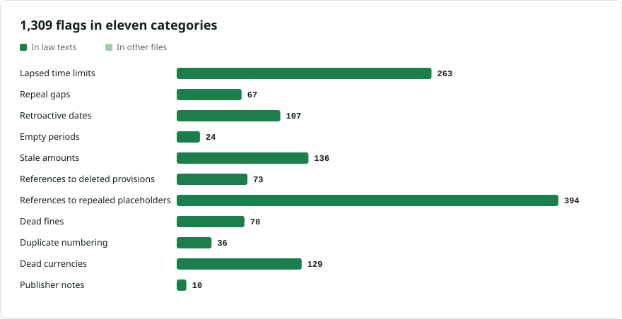

# Vulnerabilities in Maltese law

[Malti](README.md) · **English**

<picture>
<source media="(prefers-color-scheme: dark)" srcset="img/flags-by-category-dark.svg">

</picture>

The vulnerability detectors from [lexifina/global-law](https://github.com/lexifina/global-law/tree/main/vulnerabilities) look for mechanical mistakes in legislation: a rule applying "until" a date that has passed, a time limit extended only after it had run out, a provision repealed before its replacement took effect, an amount changed in one place but still standing in another, a reference to an article that no longer exists. global-law's published list (9 November 2026) covered Malta with 745 flags: 186 lapsed time limits, 158 references to repealed placeholders, 135 stale amounts, 107 retroactive dates, 67 repeal gaps, 37 duplicate numbering, 35 references to deleted provisions, 10 failed amendments (here publisher notes), 6 empty periods and 4 dead currencies. This is a run over this repository only, every Chapter and piece of subsidiary legislation on legislation.mt, as it stood at commit [`552800b`](https://github.com/lexifina/malta-law/commit/552800b788fc32478e83a6d0f7697357ee82a3cf) on 15 November 2026, with versions up to the point in time of 6 October 2026. It finds 1,309 flags: the same 67 repeal gaps, 107 retroactive dates and 10 publisher notes, about as many stale amounts (136) and duplicate numbers (36), more lapsed time limits (263), references to repealed placeholders (394), references to deleted provisions (73) and empty periods (24), many more dead currencies (129, nearly all amounts in Maltese liri written "Lm", which the search did not read before this run), and one category that list did not have for Malta: dead fines (70).

**In short:** the detectors raised 1,309 flags. A language model reviewed 223 of the strongest, arguing each one for and against; 76 survived. Checked by hand in this repository, none of the 76 is a drafting mistake. 34 are the national minimum wage of one year, which still stands in that year's own order after the wage regulation orders moved on; 20 were misread by a detector, 15 of them entries in the exemption tables of the regulations on hazardous substances in electrical equipment; 9 come from how this repository is built (an article's text kept in the file of the article before it, a schedule filed under another name) and 3 from the versions and margin notes it copies from legislation.mt; 5 are Legal Notices that set an earlier commencement themselves; 4 are spent; and 1 cannot be decided from this repository (L.N. 362 of 2024, which comes into force on a day the Minister sets by notice). Reading the categories the model does not review turned up three likely drafting mistakes, each a reference left behind when an amending Act deleted the provision it points to. Article 48 of the Duty on Documents and Transfers Act still sets a penalty for failing to comply with article 39, which the Budget Measures Implementation Act, 2014 (Act XII of 2014) deleted in the same Part that amended article 48 itself. Article 274 of the Merchant Shipping Act still applies article 229 to load line certificates, deleted by Act I of 2025. Article 40 of the Criminal Code still applies article 36 to deaf-mutes aged fourteen to eighteen, deleted by Act III of 2014. Later, this will be formalised in Lean, similar to our work on [the US tax code](https://lexifina.com/blog/formalizing-the-us-tax-code) and [US case law](https://lexifina.com/blog/formalizing-all-us-case-law-in-lean).

A flag is a prompt to look, not legal advice, and nothing here has been tested in court.

## Flags by category

| Category | What it looks for | Flags | In law texts | Reviewed | Survived review |
| --- | --- | ---: | ---: | ---: | ---: |
| Lapsed time limits | Text still applying a rule "until" a date that has passed | 263 | 263 | 40 | 2 |
| Repeal gaps | A provision removed before its replacement took effect | 67 | 67 | 39 | 7 |
| Retroactive or pre-publication dates | A change in force before the law that made it was published | 107 | 107 | 40 | 7 |
| Empty periods | A time limit extended by a law that took effect after it had run out | 24 | 24 | 24 | 15 |
| Stale amounts | An amount changed in one place but still standing elsewhere | 136 | 136 | 40 | 34 |
| References to deleted provisions | A provision citing an article that no longer exists | 73 | 73 | 40 | 11 |
| References to repealed placeholders | A provision citing an article that now reads only "Repealed" or "Deleted" | 394 | 394 | 0 | 0 |
| Dead fines | A penalty for breaching an article that has been repealed | 70 | 70 | 0 | 0 |
| Duplicate numbering | Two units with the same number in one provision | 36 | 36 | 0 | 0 |
| Dead currencies | Amounts in currencies no longer in use | 129 | 129 | 0 | 0 |
| Publisher notes | Notes that an amendment could not be carried out, and words such as "cannot be executed" | 10 | 10 | 0 | 0 |

"In law texts" counts every file of the Chapters (`cap/`) and of the subsidiary legislation (`sl/`). Not law are the root files, `data/` and `tools/`; no flag is there. Every article, regulation and schedule is a file here. legislation.mt keeps a repealed provision as a line ("Repealed by: XII. 2003.52.", "(Deleted by L.N. 476 of 2004)"), so most repealed provisions are placeholders rather than deleted files, and references to them are the largest category. The history begins at each law's earliest version on legislation.mt: the 5,053 first versions are read as the starting text, the 1,965 amendments and the 244 changes no law is credited with count as changes, and the 3,222 date corrections are left out. An amendment carries the day the amending law was published (`Published:`), so the search for retroactive dates compares it with the day the version took effect; a Legal Notice "deemed to have come into force" on an earlier day is flagged, and is usually lawful. The detectors found no two laws changing the same provision on the same day.

*Edge cases: the 76 flags that survived the review, grouped by what they turned out to be, the three likely mistakes found by reading, and what the other flags are, in [EDGE-CASES.en.md](EDGE-CASES.en.md).*

## Problems found in this repository

- **First versions that hold later text:** 877 of the 5,053 first versions (`Kind: consolidated`) carry margin notes citing laws of a later year than the version's own date, 501 of them five years later or more. The Conservation of Wild Birds Regulations (S.L. 549.42) begin with [a version dated 21 December 2010](https://github.com/lexifina/malta-law/commit/60054177db7d4d9513e1f9218c36a73f97b5ffcd) whose title page lists amendments up to Legal Notice 367 of 2020; the Plant Quarantine (Harmful Organisms) Regulations (S.L. 433.3) with [one dated 23 July 2010](https://github.com/lexifina/malta-law/commit/c758d55b006e1cf957cbc55b0258c0c766ae42b5) whose regulation 4C was amended by L.N. 354 of 2017. For these laws a date before the later amendments gives text that was not yet in force, and `git blame` credits it to the first version.
- **Articles with no file of their own:** at least 278 articles and regulations in 151 laws begin inside the file of the unit before them, where the PDF puts a margin heading, a footnote mark or no space before the number ("Rape. 198. (1)", "17.* (1)", "33A.(1)"). Article 198 of the Criminal Code is at the end of [`cap/9/197.md`](https://github.com/lexifina/malta-law/blob/552800b788fc32478e83a6d0f7697357ee82a3cf/cap/9/197.md), and articles 1712A to 1712E and 1712G of the Civil Code are in [`cap/16/1712.md`](https://github.com/lexifina/malta-law/blob/552800b788fc32478e83a6d0f7697357ee82a3cf/cap/16/1712.md). A version that parses differently moves the text into a file of its own and out again, which the history records as deletions and re-insertions (six of the survivors below).
- **Changes credited or dated wrongly:** the margin notes of the Bye-Laws for the Degree of Master of Arts in Catholic School Leadership (S.L. 327.530) say "Renumbered by: L.N. 245 of 2025" where the title page lists Legal Notice 245 of 2024, so part of the change of 1 October 2024 is [credited](https://github.com/lexifina/malta-law/commit/d7f9d352995af6c8052abde96d24a8adcef4fba0) to L.N. 245 of 2025, a bye-law on a Ph.D. degree that does not amend S.L. 327.530. In the Housing (Decontrol) Ordinance (Cap. 158), [the version of 4 February 2021](https://github.com/lexifina/malta-law/commit/3ab99574953ac0b9f87848cbf185821e9c001fe8) already holds the changes of Act XXIV of 2021, assented to on 28 May 2021 with no commencement provision; the version of 2 March 2021 does not, so articles 12C, 12D, 17 and 18 appear, disappear and come back on 28 May 2021.

## Files

| File | What it holds |
| --- | --- |
| [data/flags.csv](data/flags.csv) | Every flag, one row per provision and issue |
| [data/reviewed.csv](data/reviewed.csv) | The 223 flags the model reviewed, with its verdict and reason |
| [data/by_category.csv](data/by_category.csv) | The counts in the table above |
| [tools/](tools/) | The scripts that made this run |

Columns: `category` and `category_mt` (the category in English and Maltese), `detector`, `kind` (`law` or `other`), `path` (the article, regulation or schedule in this repository; for a retroactive date, the first file the amending law changed that day), `date` (the date the flag turns on), `reference` (the law or line involved), `summary`, `score` (the detector's ranking, 0 to 1), `review` (`artefact`, `lawful` or `candidate_defect`), `survives_rebuttal`, `review_note` (the model's reason, in English), `url` (the file at the commit that was read, or, for a file removed since, at the last commit that held it; for a retroactive date, the commit that made the change that day).

## How it was made

- **Detectors:** global-law's [vulnerabilities/scripts](https://github.com/lexifina/global-law/tree/main/vulnerabilities/scripts), with the fixes in [tools/patch_detectors.py](tools/patch_detectors.py) and the other patches in [tools/](tools/), run on this repository at commit `552800b`. For this run the search for dead currencies reads the Maltese lira as Maltese law writes it, "Lm" before an amount ("Lm15,000,000") and "liri" ([tools/patch_mt.py](tools/patch_mt.py)), and no longer takes "Cabernet Franc" or the "Dinaric" pine forests for the franc and the dinar. The history table the detectors read was built from this repository's own commits (the law that made each change and the day of its version): 2,209 changes count as law, the 5,053 first versions as the starting text.
- **Model review:** gpt-5.4-mini, the 40 strongest flags per category; the 40 strongest lapsed time limits in law texts are the same 40. One pass says whether a flag is real, a second argues that it is not. Empty periods use global-law's own review for that category, on all 24, followed by the same second pass. The model does not review the last five categories. One repeal gap, three days in February 2024 without article 198 of the Criminal Code (rape), was refused by the model service's content filter; read by hand, it is the merged file described above. global-law's own list used a different model.
- **Hand check:** every flag that survived was read in this repository's history and texts, and the amending laws behind the retroactive dates and the open cases were read on legislation.mt (Legal Notices 331 of 2021, 373 of 2021, 220 of 2022, 275 of 2023, 193 of 2024, 362 of 2024, 245 of 2025, 176 of 2026 and 242 of 2026; Acts III and XII of 2014, XXIV of 2021 and I of 2025). All 70 dead fines were read, as were samples of the other categories. The texts here are the English ones; the Maltese text, which prevails for most laws, was not compared.

To report a correction, open an issue with the provision and an official source.

## Licence

The lists and notes are Lexifina's, dedicated to the public domain under CC0 1.0 like this repository's own contributions. Quoted law text is from legislation.mt (Legislation Unit, Government of Malta); the Copyright Act (Cap. 415, article 2) excludes "any written law" from literary works, save as provided in article 12 of the Statute Law Revision Act, 1980. Only the Government Gazette is authoritative. See [LICENSE](../LICENSE).
