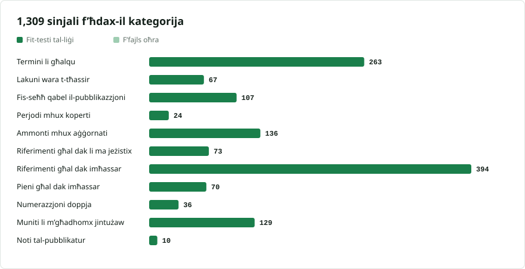

# Vulnerabbiltajiet fil-liġi Maltija

**Malti** · [English](README.en.md)

<picture>
<source media="(prefers-color-scheme: dark)" srcset="img/flags-by-category-dark.mt.svg">

</picture>

Id-detetturi tal-vulnerabbiltajiet ta’ [lexifina/global-law](https://github.com/lexifina/global-law/tree/main/vulnerabilities) ifittxu żbalji mekkaniċi fil-leġiżlazzjoni: regola li għadha tapplika “sa” data li għaddiet, terminu mtawwal biss wara li kien għalaq, dispożizzjoni mħassra qabel ma daħlet fis-seħħ dik li tieħu postha, ammont mibdul f’post wieħed iżda li għadu jidher f’ieħor, riferiment għal artikolu li m’għadux jeżisti. Il-lista ppubblikata ta’ global-law (9 ta’ Novembru 2026) kienet tkopri lil Malta b’745 sinjal: termini li għalqu (186), riferimenti għal dispożizzjonijiet imħassra (158), ammonti mhux aġġornati (135), dħul fis-seħħ qabel il-pubblikazzjoni (107), lakuni wara t-tħassir (67), numerazzjoni doppja (37), riferimenti għal dispożizzjonijiet li m’għadhomx jeżistu (35), emendi li ma setgħux isiru (10, hawn noti tal-pubblikatur), perjodi mhux koperti (6) u muniti li m’għadhomx jintużaw (4). Dan huwa eżami ta’ dan ir-repożitorju biss, kull Kapitlu u kull biċċa leġiżlazzjoni sussidjarja fuq legislation.mt, kif kien fil-commit [`552800b`](https://github.com/lexifina/malta-law/commit/552800b788fc32478e83a6d0f7697357ee82a3cf) tal-15 ta’ Novembru 2026, b’verżjonijiet sal-punt fiż-żmien tas-6 ta’ Ottubru 2026. Isib 1,309 sinjali: l-istess lakuni wara t-tħassir (67), l-istess dħul fis-seħħ qabel il-pubblikazzjoni (107) u l-istess noti tal-pubblikatur (10), bejn wieħed u ieħor l-istess ammonti mhux aġġornati (136) u numerazzjoni doppja (36), aktar termini li għalqu (263), riferimenti għal dispożizzjonijiet imħassra (394), riferimenti għal dispożizzjonijiet li m’għadhomx jeżistu (73) u perjodi mhux koperti (24), ħafna aktar muniti li m’għadhomx jintużaw (129, kważi kollha ammonti f’liri Maltin miktuba “Lm”, li t-tfittxija ma kinitx taqra qabel dan l-eżami), u kategorija waħda li dik il-lista ma kellhiex għal Malta: pieni għal ksur ta’ dispożizzjonijiet imħassra (70).

**Fil-qosor:** id-detetturi taw 1,309 sinjali. Mudell lingwistiku eżamina 223 mill-aktar b’saħħithom, u għal kull wieħed ressaq argumenti favur u kontra; 76 baqgħu wieqfa. Meta ġew ivverifikati bl-idejn f’dan ir-repożitorju, ebda wieħed minn dawn is-76 ma huwa żball fit-tfassil. 34 huma l-paga minima nazzjonali ta’ sena partikolari, li għadha tidher fl-ordni ta’ dik is-sena wara li l-ordnijiet dwar ir-regolament tal-pagi għaddew għal ċifri ġodda; 20 inqraw ħażin minn detettur, 15 minnhom daħliet fit-tabelli tal-eżenzjonijiet tar-regolamenti dwar sustanzi perikolużi f’tagħmir elettriku; 9 ġejjin minn kif inbena dan ir-repożitorju (it-test ta’ artikolu miżmum fil-fajl tal-artikolu ta’ qablu, skeda ffajljata taħt isem ieħor) u 3 mill-verżjonijiet u n-noti fil-marġni li jikkopja minn legislation.mt; 5 huma Avviżi Legali li huma stess jagħtu data ta’ dħul fis-seħħ aktar kmieni; 4 m’għandhomx aktar effett; u wieħed ma jistax jiġi deċiż minn dan ir-repożitorju (l-A.L. 362 tal-2024, li jidħol fis-seħħ f’data li l-Ministru jistabbilixxi b’avviż). Il-qari tal-kategoriji li l-mudell ma jeżaminax wassal għal tliet żbalji probabbli fit-tfassil, kull wieħed riferiment li baqa’ wara li Att emendatorju ħassar id-dispożizzjoni li jirreferi għaliha. L-artikolu 48 tal-Duty on Documents and Transfers Act għadu jistabbilixxi penali għal min jonqos milli jħares l-artikolu 39, li l-Budget Measures Implementation Act, 2014 (l-Att XII tal-2014) ħassar fl-istess Taqsima li fiha emenda l-artikolu 48 innifsu. L-artikolu 274 tal-Merchant Shipping Act għadu japplika l-artikolu 229 għaċ-ċertifikati tal-linja tat-tagħbija, li ħassru l-Att I tal-2025. L-artikolu 40 tal-Kodiċi Kriminali għadu japplika l-artikolu 36 għas-surdi-muti ta’ bejn erbatax u tmintax-il sena, li ħassru l-Att III tal-2014. Aktar ’il quddiem, dan se jiġi fformalizzat f’Lean, bħalma għamilna għall-[kodiċi tat-taxxa tal-Istati Uniti](https://lexifina.com/blog/formalizing-the-us-tax-code) u għall-[ġurisprudenza tal-Istati Uniti](https://lexifina.com/blog/formalizing-all-us-case-law-in-lean).

Sinjal huwa stedina biex wieħed iħares, mhux parir legali, u xejn minn dan ma ġie ttestjat quddiem qorti.

## Sinjali skont il-kategorija

| Kategorija | X’tfittex | Sinjali | Fit-testi tal-liġi | Eżaminati | Baqgħu wieqfa |
| --- | --- | ---: | ---: | ---: | ---: |
| Termini li għalqu | Test li għadu japplika regola “sa” data li għaddiet | 263 | 263 | 40 | 2 |
| Lakuni wara t-tħassir | Dispożizzjoni mneħħija qabel ma daħlet fis-seħħ dik li tieħu postha | 67 | 67 | 39 | 7 |
| Dħul fis-seħħ qabel il-pubblikazzjoni | Bidla fis-seħħ qabel ma ġiet ippubblikata l-liġi li għamlitha | 107 | 107 | 40 | 7 |
| Perjodi mhux koperti | Terminu mtawwal b’liġi li daħlet fis-seħħ wara li kien għalaq | 24 | 24 | 24 | 15 |
| Ammonti mhux aġġornati | Ammont mibdul f’post wieħed iżda li għadu jidher f’ieħor | 136 | 136 | 40 | 34 |
| Riferimenti għal dispożizzjonijiet li m’għadhomx jeżistu | Dispożizzjoni li tirreferi għal artikolu li m’għadux jeżisti | 73 | 73 | 40 | 11 |
| Riferimenti għal dispożizzjonijiet imħassra | Dispożizzjoni li tirreferi għal artikolu li issa jgħid biss “Repealed” jew “Deleted” | 394 | 394 | 0 | 0 |
| Pieni għal ksur ta’ dispożizzjonijiet imħassra | Piena għall-ksur ta’ artikolu li tħassar | 70 | 70 | 0 | 0 |
| Numerazzjoni doppja | Żewġ unitajiet bl-istess numru fl-istess dispożizzjoni | 36 | 36 | 0 | 0 |
| Muniti li m’għadhomx jintużaw | Ammonti f’muniti li m’għadhomx jintużaw | 129 | 129 | 0 | 0 |
| Noti tal-pubblikatur | Noti li emenda ma setgħetx issir, u kliem bħal “cannot be executed” | 10 | 10 | 0 | 0 |

“Fit-testi tal-liġi” jgħodd kull fajl tal-Kapitli (`cap/`) u tal-leġiżlazzjoni sussidjarja (`sl/`). Mhumiex liġi l-fajls fl-għerq tar-repożitorju, `data/` u `tools/`; ebda sinjal ma jinsab fihom. Kull artikolu, regolament u skeda huwa fajl hawnhekk. legislation.mt iżomm dispożizzjoni mħassra bħala linja waħda (“Repealed by: XII. 2003.52.”, “(Deleted by L.N. 476 of 2004)”), għalhekk il-biċċa l-kbira tad-dispożizzjonijiet imħassra jibqgħu fajls b’din il-linja minflok ma jitneħħew, u r-riferimenti għalihom huma l-akbar kategorija. L-istorja tibda mill-ewwel verżjoni ta’ kull liġi fuq legislation.mt: il-5,053 ewwel verżjoni jinqraw bħala t-test tal-bidu, l-1,965 emenda u l-244 bidla li ma jistgħux jiġu attribwiti lil ebda liġi jitqiesu bħala bidliet, u l-3,222 korrezzjoni tad-dati jitħallew barra. Kull emenda ġġorr il-jum li fih ġiet ippubblikata l-liġi emendatorja (`Published:`), għalhekk it-tfittxija għad-dħul fis-seħħ qabel il-pubblikazzjoni tqabblu mal-jum li fih daħlet fis-seħħ il-verżjoni; Avviż Legali li “jitqies li daħal fis-seħħ” f’data aktar kmieni jiġi mmarkat, u ġeneralment huwa legali. Id-detetturi ma sabu ebda żewġ liġijiet li biddlu l-istess dispożizzjoni fl-istess jum.

*Każijiet fit-tarf: is-76 sinjal li baqgħu wieqfa wara r-reviżjoni, miġbura skont x’irriżultaw li huma, it-tliet żbalji probabbli misjuba bil-qari, u x’inhuma s-sinjali l-oħra, f’[EDGE-CASES.md](EDGE-CASES.md).*

## Problemi misjuba f’dan ir-repożitorju

- **Ewwel verżjonijiet li fihom test aktar tard:** 877 mill-5,053 ewwel verżjoni (`Kind: consolidated`) għandhom noti fil-marġni li jsemmu liġijiet ta’ sena aktar tard mid-data tal-verżjoni nnifisha, 501 minnhom ħames snin jew aktar wara. Il-Conservation of Wild Birds Regulations (L.S. 549.42) jibdew b’[verżjoni datata 21 ta’ Diċembru 2010](https://github.com/lexifina/malta-law/commit/60054177db7d4d9513e1f9218c36a73f97b5ffcd) li l-paġna tat-titlu tagħha telenka emendi sal-Avviż Legali 367 tal-2020; il-Plant Quarantine (Harmful Organisms) Regulations (L.S. 433.3) b’[waħda datata 23 ta’ Lulju 2010](https://github.com/lexifina/malta-law/commit/c758d55b006e1cf957cbc55b0258c0c766ae42b5) li r-regolament 4C tagħha ġie emendat bl-A.L. 354 tal-2017. Għal dawn il-liġijiet, data ta’ qabel l-emendi l-aktar riċenti tagħti test li kien għadu mhux fis-seħħ, u `git blame` jattribwih lill-ewwel verżjoni.
- **Artikoli mingħajr fajl tagħhom:** mill-inqas 278 artikolu u regolament f’151 liġi jibdew ġewwa l-fajl tal-unità ta’ qabilhom, fejn il-PDF ipoġġi intestatura fil-marġni, marka ta’ nota f’qiegħ il-paġna jew ebda spazju qabel in-numru (“Rape. 198. (1)”, “17.* (1)”, “33A.(1)”). L-artikolu 198 tal-Kodiċi Kriminali jinsab fl-aħħar ta’ [`cap/9/197.md`](https://github.com/lexifina/malta-law/blob/552800b788fc32478e83a6d0f7697357ee82a3cf/cap/9/197.md), u l-artikoli 1712A sa 1712E u 1712G tal-Kodiċi Ċivili f’[`cap/16/1712.md`](https://github.com/lexifina/malta-law/blob/552800b788fc32478e83a6d0f7697357ee82a3cf/cap/16/1712.md). Verżjoni li tinqara b’mod differenti ġġorr it-test f’fajl għalih u terġa’ toħorġu, u l-istorja tirreġistra dan bħala tħassir u reinserzjoni (sitta mis-sinjali li baqgħu wieqfa).
- **Bidliet attribwiti jew datati ħażin:** in-noti fil-marġni tal-Bye-Laws for the Degree of Master of Arts in Catholic School Leadership (L.S. 327.530) jgħidu “Renumbered by: L.N. 245 of 2025” fejn il-paġna tat-titlu telenka l-Avviż Legali 245 tal-2024, għalhekk parti mill-bidla tal-1 ta’ Ottubru 2024 hija [attribwita](https://github.com/lexifina/malta-law/commit/d7f9d352995af6c8052abde96d24a8adcef4fba0) lill-A.L. 245 tal-2025, regolament tal-Università dwar grad ta’ Ph.D. li ma jemendax il-L.S. 327.530. Fil-Housing (Decontrol) Ordinance (Kap. 158), [il-verżjoni tal-4 ta’ Frar 2021](https://github.com/lexifina/malta-law/commit/3ab99574953ac0b9f87848cbf185821e9c001fe8) diġà fiha l-bidliet tal-Att XXIV tal-2021, li ngħata l-kunsens fit-28 ta’ Mejju 2021 u m’għandux dispożizzjoni dwar id-dħul fis-seħħ; il-verżjoni tat-2 ta’ Marzu 2021 m’għandhomx, u għalhekk l-artikoli 12C, 12D, 17 u 18 jidhru, jisparixxu u jerġgħu lura fit-28 ta’ Mejju 2021.

## Fajls

| Fajl | X’fih |
| --- | --- |
| [data/flags.csv](data/flags.csv) | Kull sinjal, ringiela waħda għal kull dispożizzjoni u kwistjoni |
| [data/reviewed.csv](data/reviewed.csv) | Is-223 sinjal li eżamina l-mudell, bid-deċiżjoni u r-raġuni tiegħu |
| [data/by_category.csv](data/by_category.csv) | In-numri tat-tabella ta’ hawn fuq |
| [tools/](tools/) | L-iskripts li għamlu dan l-eżami |

Kolonni: `category` u `category_mt` (il-kategorija bl-Ingliż u bil-Malti), `detector`, `kind` (`law` jew `other`), `path` (l-artikolu, ir-regolament jew l-iskeda f’dan ir-repożitorju; għal dħul fis-seħħ qabel il-pubblikazzjoni, l-ewwel fajl li l-liġi emendatorja biddlet dakinhar), `date` (id-data li fuqha jserraħ is-sinjal), `reference` (il-liġi jew il-linja kkonċernata), `summary`, `score` (il-klassifika tad-detettur, minn 0 sa 1), `review` (`artefact`, `lawful` jew `candidate_defect`), `survives_rebuttal`, `review_note` (ir-raġuni tal-mudell, bl-Ingliż), `url` (il-fajl fil-commit li nqara, jew, għal fajl li tneħħa minn dakinhar, fl-aħħar commit li kien fih; għal dħul fis-seħħ qabel il-pubblikazzjoni, il-commit li għamel il-bidla dakinhar).

## Kif sar

- **Detetturi:** l-[iskripts tal-vulnerabbiltajiet](https://github.com/lexifina/global-law/tree/main/vulnerabilities/scripts) ta’ global-law, bit-tiswijiet f’[tools/patch_detectors.py](tools/patch_detectors.py) u l-patches l-oħra f’[tools/](tools/), imħaddma fuq dan ir-repożitorju fil-commit `552800b`. Għal dan l-eżami, it-tfittxija għall-muniti li m’għadhomx jintużaw taqra l-lira Maltija kif tiktibha l-liġi Maltija, “Lm” qabel ammont (“Lm15,000,000”) u “liri” ([tools/patch_mt.py](tools/patch_mt.py)), u ma tibqax tieħu “Cabernet Franc” jew il-foresti tal-arżnu “Dinaric” għall-frank u d-dinar. It-tabella tal-istorja li jaqraw id-detetturi nbniet mill-commits ta’ dan ir-repożitorju stess (il-liġi li għamlet kull bidla u l-jum tal-verżjoni tagħha): 2,209 bidliet jitqiesu bħala liġi, u l-5,053 ewwel verżjoni bħala t-test tal-bidu.
- **Reviżjoni mill-mudell:** gpt-5.4-mini, l-40 sinjal l-aktar b’saħħithom f’kull kategorija; l-40 terminu li għalqu l-aktar b’saħħithom fit-testi tal-liġi huma l-istess 40. Passata waħda tgħid jekk sinjal huwiex reali, it-tieni waħda targumenta li mhuwiex. Il-perjodi mhux koperti jużaw ir-reviżjoni proprja ta’ global-law għal dik il-kategorija, fuq l-24 kollha, segwita mill-istess it-tieni passata. Il-mudell ma jeżaminax l-aħħar ħames kategoriji. Lakuna waħda wara t-tħassir, tliet ijiem fi Frar 2024 mingħajr l-artikolu 198 tal-Kodiċi Kriminali (stupru), ġiet miċħuda mill-filtru tal-kontenut tas-servizz tal-mudell; meta nqrat bl-idejn, hija l-fajl magħqud deskritt hawn fuq. Il-lista proprja ta’ global-law użat mudell ieħor.
- **Verifika bl-idejn:** kull sinjal li baqa’ wieqaf inqara fl-istorja u fit-testi ta’ dan ir-repożitorju, u l-liġijiet emendatorji wara d-dħul fis-seħħ qabel il-pubblikazzjoni u l-każijiet miftuħa nqraw fuq legislation.mt (l-Avviżi Legali 331 tal-2021, 373 tal-2021, 220 tal-2022, 275 tal-2023, 193 tal-2024, 362 tal-2024, 245 tal-2025, 176 tal-2026 u 242 tal-2026; l-Atti III u XII tal-2014, XXIV tal-2021 u I tal-2025). Is-70 piena għal ksur ta’ dispożizzjonijiet imħassra nqraw kollha, kif ukoll kampjuni tal-kategoriji l-oħra. It-testi hawnhekk huma dawk Ingliżi; it-test Malti, li għall-biċċa l-kbira tal-liġijiet jipprevali, ma ġiex imqabbel.

Biex tirrapporta korrezzjoni, iftaħ issue bid-dispożizzjoni u b’sors uffiċjali.

## Liċenzja

Il-listi u n-noti huma ta’ Lexifina, dedikati lid-dominju pubbliku taħt CC0 1.0 bħall-kontribuzzjonijiet proprji ta’ dan ir-repożitorju. It-test tal-liġi kkwotat huwa minn legislation.mt (l-Unità tal-Leġiżlazzjoni, Gvern ta’ Malta); l-Att dwar id-Drittijiet tal-Awtur (Kap. 415, artikolu 2) jeskludi “any written law” (kull liġi miktuba) mix-xogħlijiet letterarji, ħlief kif provdut fl-artikolu 12 tal-Att tal-1980 dwar ir-Reviżjoni tal-Liġijiet Statutarji. It-test awtorevoli huwa biss dak tal-Gazzetta tal-Gvern. Ara [LICENSE](../LICENSE).

Din hija traduzzjoni tal-verżjoni Ingliża ([README.en.md](README.en.md)); jekk ikun hemm differenza, tipprevali l-verżjoni Ingliża.
